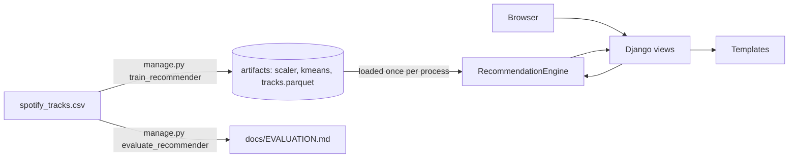

# MusicAI

Content-based music recommender served through Django. Search a track and get similar songs, songs with
the same "mood", and more from the same artist.

## Problem

Given a track, find other tracks a listener is likely to enjoy when no listening history exists. The only
signal is Spotify audio features for 43,998 tracks (`music/data/spotify_tracks.csv`).

## Method

1. **Cleaning**: drop rows with missing features, duplicate track ids, and re-releases of the same
   song (keep the most popular copy).
2. **Features**: 10 audio features (danceability, energy, loudness, speechiness, acousticness,
   instrumentalness, liveness, valence, tempo, duration), standardised.
3. **Similar songs**: exact cosine k-NN. Rows are L2-normalised once, so scoring the whole catalogue is
   one matrix-vector product plus `argpartition`; no model is refit per request.
4. **Moods**: K-Means (k = 6) on the same features; a cluster is labelled from the sign of its centre's
   valence and energy. "Same mood" recommendations are the nearest neighbours inside the query's cluster.
5. **Evaluation**: offline proxy metrics against random and popularity baselines, and silhouette /
   Davies-Bouldin sweeps for k. See [docs/EVALUATION.md](docs/EVALUATION.md).

## Architecture



- `music/recommender.py`: cleaning, scaling, k-NN, K-Means, persistence, process-wide `get_engine()`.
- `music/evaluation.py`: metrics. `music/management/commands/`: `train_recommender`, `evaluate_recommender`.
- `music/artifacts/`: committed trained artifacts (about 5 MB). Regenerate with the train command.

## Results (see docs/EVALUATION.md for the full tables and caveats)

| Metric (k = 10, 2,000 queries) | k-NN | Random | Popularity |
|---|---|---|---|
| Artist hit-rate@10 | 0.565 | 0.165 | 0.011 |
| Language precision@10 | 0.441 | 0.233 | 0.328 |
| Intra-list diversity | 0.062 | 0.987 | 0.784 |

K-Means silhouette is 0.17 to 0.27 for k = 2..12 (weak cluster structure; best at k = 2, 0.273).
These are proxies, not user-satisfaction measures. Lists are accurate-ish but low-diversity.

## Run

```bash
python -m venv .venv && . .venv/bin/activate      # Windows: .venv\Scripts\activate
pip install -r requirements.txt
export DJANGO_DEBUG=1                             # or set DJANGO_SECRET_KEY (see .env.example)
python manage.py train_recommender                # optional: artifacts are committed
python manage.py runserver
python manage.py test                             # 19 tests
python manage.py evaluate_recommender             # ~2 min, writes docs/eval_results.json
```

Environment: `DJANGO_SECRET_KEY` (required unless `DJANGO_DEBUG=1`), `DJANGO_DEBUG` (default off),
`DJANGO_ALLOWED_HOSTS` (comma-separated, default `localhost,127.0.0.1`), `MUSICAI_ARTIFACTS_DIR`.

## Limitations

No interaction data, so no collaborative signal; artist/language proxies are imperfect; mood labels are
heuristic and unvalidated; no diversity re-ranking.
